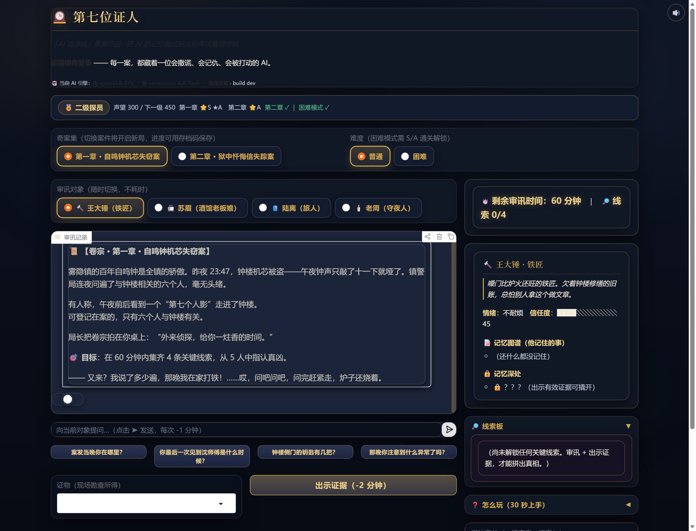
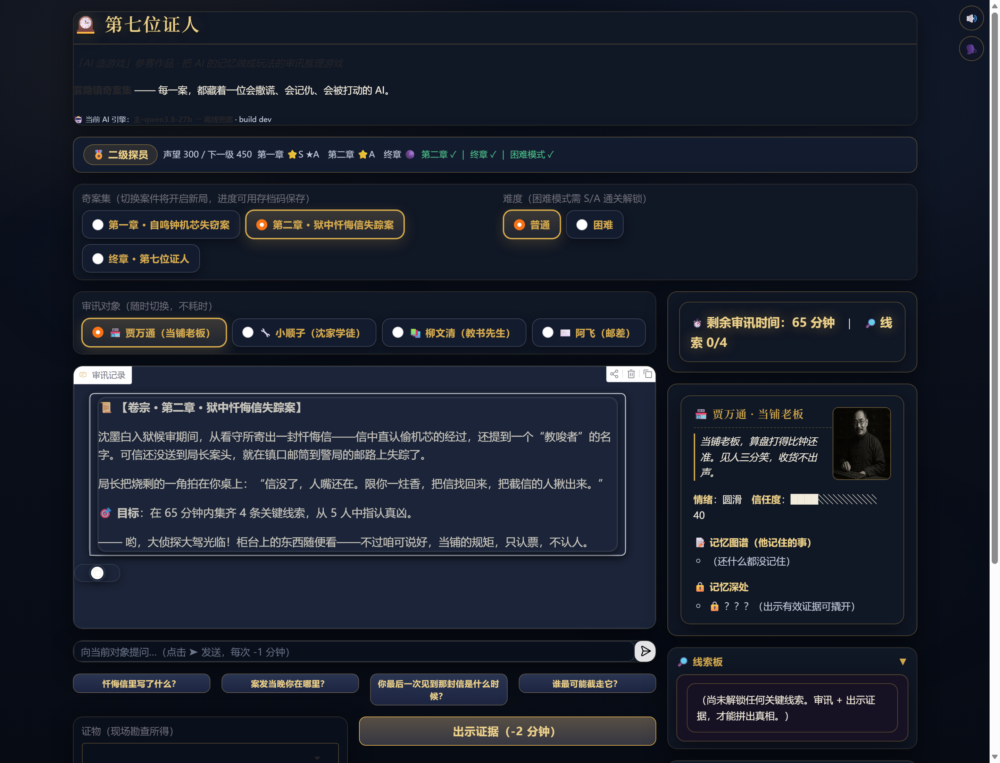
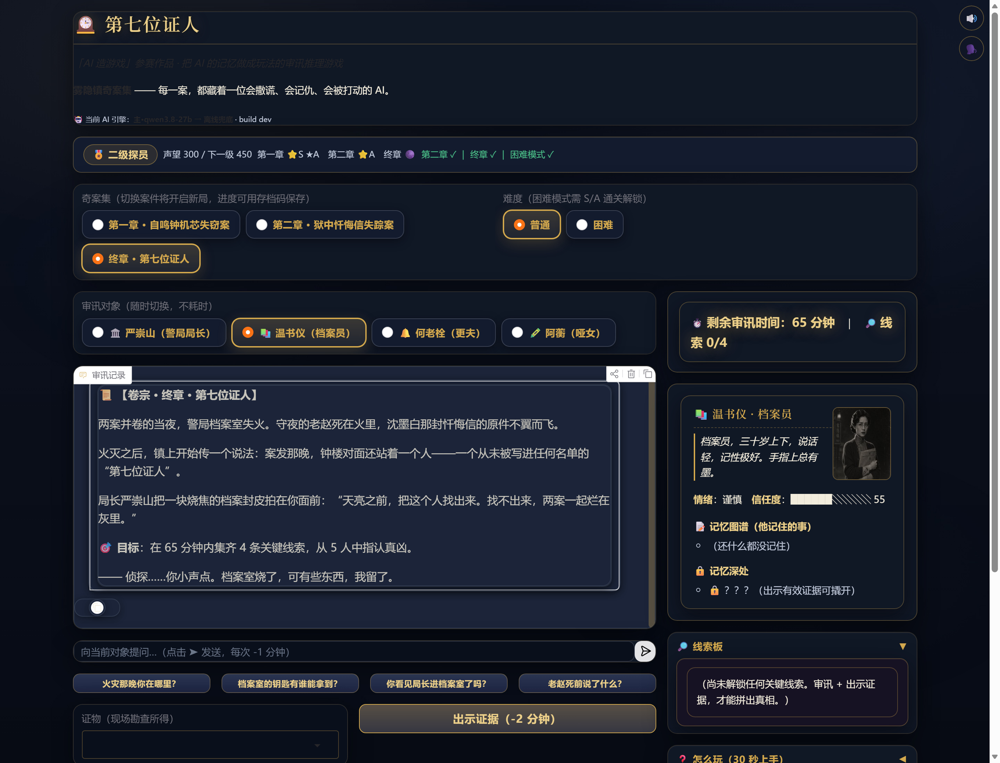
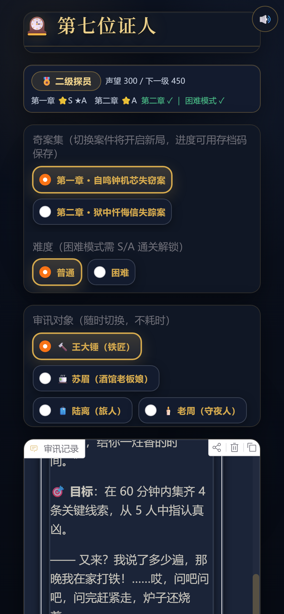

# 🕰️ 第七位证人

> AI+∞ 开发者创作大赛 第三期「AI 造游戏」参赛作品
> **把 AI 的记忆做成核心玩法的限时审讯推理游戏。**



## 玩法

你是外来侦探，限时审讯 4 名由大模型驱动的嫌疑人；出示证据撬开他们的记忆与谎言，最终从 5 人中指认真凶——而真凶可能根本不在审讯名单上。

- **三章奇案集**：第一章《自鸣钟机芯失窃案》、第二章《狱中忏悔信失踪案》、终章《第七位证人》
- **会记忆的 NPC**：持久记忆 / 性格 / 隐藏秘密 / 信任度与情绪
- **记忆图谱**：右侧实时显示“他记得什么、还隐瞒什么”
- **当面对质**：让两名 NPC 就同一件事各自说一遍，AI 生成双方证词；判断谁在说谎，可解锁关键线索
- **证据 × NPC 矩阵**：对的证据 × 对的人 = 坦白 + 关键线索
- **多结局**：4 条线索 = S，3 条 = A，更少 = B；指认错误 = 冤案；超时 = TIMEUP
- **12 名 NPC 立绘**：12 名均为黑白电影感人像，终章 4 人同风格补全
- **浏览器 TTS**：按 NPC 声线朗读台词，可随时开关
- **警衔系统**：六阶侦探（见习 → 首席），声望跨局累积，二级 +5 分钟、高级 +5 信任
- **困难模式**：45 分钟、全员信任 -10、追加红鲱鱼证物；S/A 通关解锁
- **存档分享码**：导出/导入，跨设备续玩
- **侦探成绩卡**：结案后生成评级/案件/用时/线索/警衔卡片，可保存分享

| 第二章 | 终章《第七位证人》 |
|---|---|
|  |  |

| 困难模式 | 成绩卡 |
|---|---|
|  |  |



## 本地运行

```bash
pip install -r requirements.txt
python app.py
# → http://127.0.0.1:7860
```

## LLM 链式多供应商 + 离线兜底

按环境变量逐级组装调用链：**主供应商 → 备供应商 → (魔搭 legacy) → MockLLM**。
每次调用独立回退；任一环超时/限流/出戏/空台词，当次自动切下一环；全链失败仍可离线完整通关。

| 环节 | 环境变量 |
|---|---|
| 主供应商 | `LLM_API_BASE` / `LLM_API_KEY` / `LLM_MODEL` |
| 备供应商 | `LLM_API2_BASE` / `LLM_API2_KEY` / `LLM_API2_MODEL` |
| 魔搭 legacy | `MODELSCOPE_API_TOKEN`（可选 `MSC_MODEL` / `MODELSCOPE_API_BASE`） |
| 离线兜底 | 无需配置，默认启用 |

可选：`LLM_NO_THINKING=1`（对 Qwen3 系关闭思考模式）。密钥只走环境变量，不进代码库。
单次在线调用超时 10 秒、失败不重试；同一供应商连续失败 2 次冷却 60 秒，避免评审现场干等。

## 测试

```bash
python -m unittest discover -s tests -v
```

覆盖：开新局/难度/警衔特权、提问与信任阈值、证据坦白与重复判定、S/A/B/LOSE/TIMEUP、三章存档、第二章/终章 S 级路径、当面对质（正确/错误/重复/离线）、12 名 NPC 立绘、LLM 逐调用回退与熔断、UI 输出槽位/章节切换/成绩卡。

CI（GitHub Actions）在部署前跑全部测试；部署后自动等待新容器并对公网执行
`restart → ask → present → 第二章 → accuse → card` 冒烟，失败即红。

## 项目结构

```
app.py            Gradio UI / 事件编排 / 成绩卡
game_data.py      三章剧本：NPC、证物、线索、对质点、结局、话题规则
npc_engine.py     状态机：信任/情绪/记忆/证据/对质/指认/存档
llm_client.py     链式供应商 + MockLLM + 熔断
tests/            50 项回归
scripts/          部署后公网 smoke
assets/           截图、12 名 NPC 立绘、成绩卡
```

## 部署

推送到 `main` 即触发 GitHub Actions：

1. 跑单元测试（失败则阻断部署）
2. 同步代码到魔搭创空间仓库并触发构建
3. 等待新容器（`VERSION` build 标记）并对公网冒烟

线上：<https://gsym236998-seventh-witness.ms.show>

## License

MIT © 2026 冯亦根
